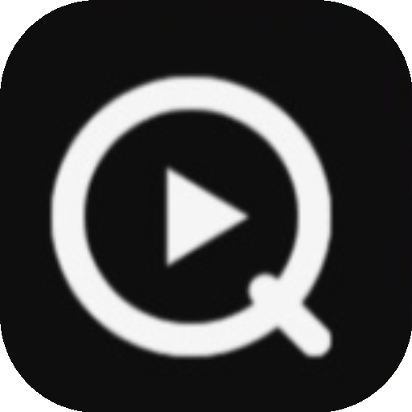

  
  
  # Qs (QuietScroll)
  
  **A minimalist, pure, ad-free local Android player designed for vertical short videos.** 
  *No algorithms. Just pure swiping.*

---

## ✨ Core Features

- 🚫 **Zero Ads, Zero Algorithms**
  No feed recommendations, no ads. Just your local videos.

- 🎨 **Minimalist Interaction**
  Swipe up/down or left/right to switch screens instantly.

- 🕒 **Resume Playback**
  Automatically remembers your progress for a seamless resume.

- ⚡ **Smart Decoding**
  Supports hardware decoding with automatic software fallback for unsupported formats. No black screens.

## 📦 Download & Install

Go to the [Releases](https://github.com/maxlanceund/Qs/releases) page to download the latest APK and install it.
